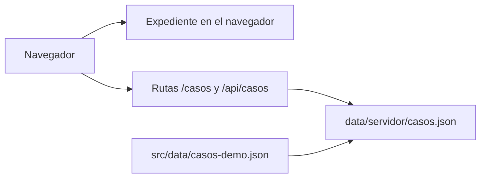

# RECADO – EIRA Movimiento Rosa

Demo del **Reto 4 de EIRA** para el Vibeathon 2026 (Nerdearla / Movimiento Rosa).

El reto pide un recorrido seguro para entregar un resultado de Papanicolaou. El problema que esta demo aísla es otro: que el documento exista no significa que la persona lo haya recibido, que haya podido abrirlo ni que el siguiente paso (por ejemplo, el transporte) esté resuelto. Recepción del aviso, acceso al PDF y acompañamiento son hechos distintos.

> **Simulación.** Pacientes, CURP, teléfonos, unidades y laboratorios son ficticios. No hay SMS, WhatsApp, llamada ni voz reales. No es un repositorio clínico ni un sistema de producción.

## Qué está implementado

- Expediente simulado en el navegador: asociar un PDF de prueba, revisión documental, autorización o rechazo de un médico humano, notificación, entrega con código y seguimiento.
- Seis casos compartidos, `DEMO-001` a `DEMO-006`, con los identificadores y alias de [`src/data/casos-demo.json`](src/data/casos-demo.json). Ana usa `DEMO-002` y Felipe usa `DEMO-001`.
- Simulador de llamada en pantalla, sin telefonía. La clave de teclado, igual en los seis casos, es `2580`. La respuesta por voz no está implementada.
- El Revisor y el Médico autorizador pueden revisar el documento antes de autorizarlo. La persona paciente no lo abre sin autorización médica, consentimiento, ausencia de escalamiento y clave correcta.
- Recepción, acceso al PDF y acompañamiento se registran por separado. Pedir apoyo de transporte no cuenta como entrega. Confirmar la recepción o pedir transporte otra vez no duplica el evento.
- Al tercer fallo de clave en `DEMO-004` el caso escala a seguimiento humano y el simulador se detiene.
- `DEMO-003` no permite contacto ni acceso de la paciente, y su guion aprobado está vacío hasta que un Médico autorizador registra la autorización.
- `DEMO-005` bloquea el contacto por falta de consentimiento. `DEMO-006` (nadie contesta) no confirma recepción y el aviso no dice «documento».
- El rol se elige en el encabezado. Cada paso del expediente exige un rol concreto. Ese selector no autentica a nadie.

## Ejecutar la aplicación

Requiere Node.js 20 o superior.

```bash
npm install
npm run dev
```

Abre http://localhost:3000. La ruta de los casos es http://localhost:3000/casos.

Para que otra máquina de la misma red abra la demo:

```bash
npx next dev --hostname 0.0.0.0 --port 3000
```

Comprobaciones locales:

```bash
npx tsc --noEmit
npm run lint
npm test
npm run build
```

## Preparar los seis casos desde un entorno nuevo

1. Instala dependencias y arranca el servidor, como arriba.
2. Abre `/casos`. Si no existe `data/servidor/casos.json`, el proceso lo crea a partir de [`src/data/casos-demo.json`](src/data/casos-demo.json). Ese archivo vivo no se versiona.
3. Si falta algún identificador, usa **Preparar casos que falten**. Solo inserta los DEMO ausentes. No reescribe casos, eventos ni notas que ya existan.
4. **Restaurar escenario demo** devuelve los campos de esos seis casos a la semilla, archiva sus eventos y conserva cualquier otro caso y las notas operativas. No lo uses mientras alguien esté probando: borra el recorrido en curso de esos seis identificadores.
5. El botón ↺ del encabezado solo reinicia los expedientes de ese navegador y sus PDF locales. No borra los casos del servidor.

La clave `2580` se muestra en la ficha del personal. No se guarda en los eventos.

## Demostración de dos minutos

1. En `/casos`, abre `DEMO-002` (Ana) o `DEMO-001` (Felipe). El panel dice «Simulador de llamada · sin conexión telefónica» y el aviso inicial no revela el documento.
2. Con el rol **Trabajo social**, escribe `2580` y comprueba la clave. El guion aprobado aparece solo después.
3. Confirma la recepción. El caso queda entregado. Confirmar otra vez informa que el evento ya existía.
4. Solicita acompañamiento por transporte. Ese evento queda aparte y el conteo de entregas no sube.
5. Abre `DEMO-003`. El contacto está deshabilitado y el intento de la paciente no muestra el PDF. Cambia a **Médico autorizador** y autoriza: entonces el guion aprobado deja de estar vacío.
6. Recarga `/casos`. El estado sigue ahí porque vive en el proceso, no en el navegador.

## Arquitectura y tecnologías

Next.js 15 (App Router) · TypeScript · Tailwind CSS v4 · shadcn/ui · zod · sonner. No hay backend externo, base de datos ni proveedor de mensajería.



- [`src/contracts/`](src/contracts/) define la máquina de estados del expediente y las reglas de los casos DEMO.
- [`src/data/repository.tsx`](src/data/repository.tsx) guarda el expediente en `localStorage` (`recado-demo-v1`). El PDF de prueba del capturista va a IndexedDB.
- [`src/data/casos-servidor.ts`](src/data/casos-servidor.ts) escribe un solo JSON con una cola en el proceso. La primera lectura crea el archivo si no existe. Un archivo corrupto se rechaza y no se borra.
- [`public/muestras/pap-ficticio.pdf`](public/muestras/pap-ficticio.pdf) es el documento de práctica. Sigue siendo un archivo público del sitio. El acceso asociado a un caso pasa por el servidor.

## Persistencia local y persistencia compartida

| Dónde | Qué guarda | Quién lo ve |
| --- | --- | --- |
| `localStorage` e IndexedDB | Expedientes, historial y el PDF asociado en ese navegador | Solo esa ventana, hasta pulsar ↺ o borrar los datos del sitio |
| `data/servidor/casos.json` | Los seis casos, sus eventos y las notas operativas | Cualquier navegador que hable con este mismo proceso |

Recargar conserva los casos. Otro equipo los ve solo si entra al mismo servidor. El archivo no se sincroniza entre máquinas y desaparece del alcance público si ese proceso se detiene. No es una base de datos clínica.

## Limitaciones

- No hay autenticación de producción, usuarios, sesión ni permisos reales. El rol simulado es una etiqueta de la interfaz.
- La voz y la telefonía están simuladas en pantalla. No se marca ningún número y no hay reconocimiento de voz.
- Los datos son exclusivamente ficticios. Las 23 pruebas de recorrido siguen pendientes hasta que quien las ejecuta las registre. Esta aplicación no las marca como aprobadas.
- Quien conozca la URL puede leer y modificar los casos ficticios. El PDF de práctica en `public/muestras/` no está protegido.
- La huella SHA-256 del PDF se calcula en el navegador para la demo. No es un sello clínico ni una firma.

## Riesgos, próximos pasos y un piloto clínico

Riesgos de esta demo: suplantación del rol, edición del archivo JSON, pérdida del estado al apagar el proceso y confusión entre el PDF público de práctica y el documento de un caso.

Próximos pasos de producto, todavía fuera de este repositorio: importar Excel o CSV, cerrar el cálculo de indicadores, validar duplicados y fechas, y exportar reportes.

Un piloto clínico exigiría, como mínimo: identidad de personal y de paciente verificable, sesión y autorización por acción, custodia cifrada del PDF con acceso revocable, auditoría inmutable, consentimiento comprobable, canal de aviso autenticado, separación del documento de práctica, respaldo y borrado, y un acuerdo de tratamiento de datos. Nada de eso está en esta demo.
